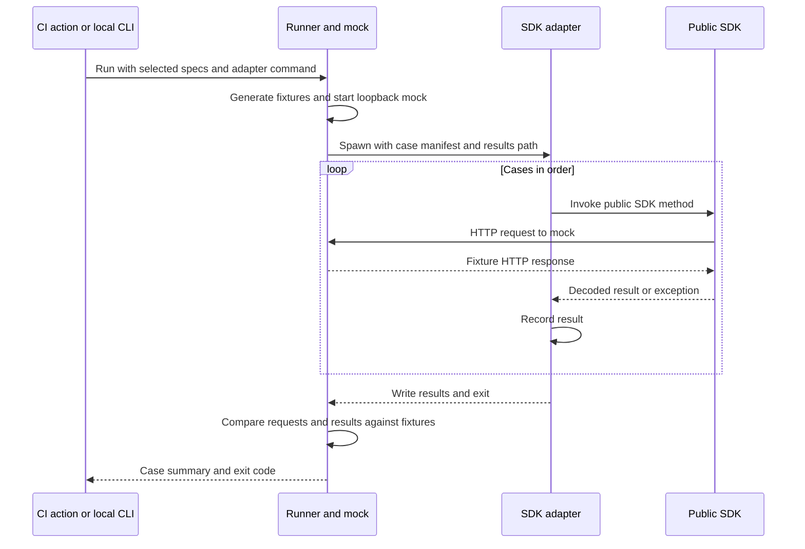
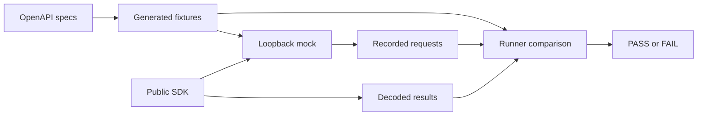
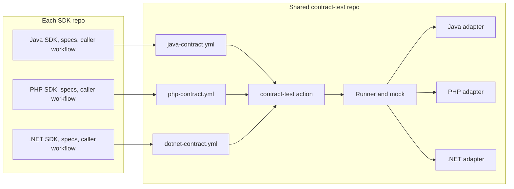

# OpenAPI SDK contract regression

A language-neutral runner generates deterministic fixtures from each OpenAPI
spec, starts a loopback mock server, and runs an SDK adapter that calls public
SDK methods against it. It then checks the requests the SDK sent and the
results it decoded — no production credentials or live eBay calls needed.

## Workflow layout

From the repository root:

```text
.github/
|-- workflows/
|   |-- contract-regression.yml   Java CI entry point
|   |-- java-contract.yml         Reusable Java job
|   |-- php-contract.yml          Reusable PHP job
|   `-- dotnet-contract.yml       Reusable .NET job
`-- actions/contract-test/
    `-- action.yml                Node setup, self-tests, runner launch
tools/contract-test/
|-- lib/
|   |-- runner.cjs                Fixtures, mock, and comparison
|   `-- test_runner.cjs           Runner tests
|-- adapters/
|   |-- java/                     Public Java SDK calls
|   |-- php/
|   |   `-- adapter.php           Public PHP SDK calls
|   `-- dotnet/                   Public .NET SDK calls
`-- gradle/
    `-- contract.init.gradle      Java adapter build setup
```

> **Key point:** This repository starts at [`contract-regression.yml`](../../.github/workflows/contract-regression.yml).
> Other SDKs call the reusable [`java-contract.yml`](../../.github/workflows/java-contract.yml)
> [`php-contract.yml`](../../.github/workflows/php-contract.yml), or
> [`dotnet-contract.yml`](../../.github/workflows/dotnet-contract.yml); each prepares
> the caller's runtime before invoking the shared
> [`action.yml`](../../.github/actions/contract-test/action.yml).

## High-level execution flow

The sequence below shows the main path for a case that sends an HTTP request.



> **Key point:** The mock lives inside the runner; the adapter is a separate
> process. `CONTRACT_CASES` and `CONTRACT_RESULTS` are file paths passed to it.

## Validation and comparison



> **Key point:** The mock serves responses; the runner compares evidence only
> after the adapter exits.

1. **Generate cases.** For each operation, use the lowest 2xx response;
   `--errors` adds the lowest declared 4xx. Ajv validates schema-sampled
   values; binary upload bytes use fixed test data.
2. **Serve and record.** The mock selects a fixture by `X-Contract-Case-Id`
   and records the request. Unknown or duplicate IDs receive 500. The mock
   does not validate the request.
3. **Call the SDK.** The adapter records the decoded response, 4xx status and
   decoded body when available, or an error for each case.
4. **Compare.** After the adapter exits, the runner checks the recorded HTTP
   request and SDK result against each fixture. Missing requests or results,
   adapter failures, unexpected IDs, and mismatched counts fail the run.

**Compared:** HTTP method, path, declared query/header values, bearer token,
non-null request body, and non-null expected response fields. For 4xx cases,
the status is also checked. Objects may have extra fields; arrays must match
in length and order. Extra query parameters and headers are allowed.

**Not directly compared:** null expected bodies, success status, and mock
response headers. `Content-Type`/`Accept` are not ordinary header checks;
binary and multipart bodies do check the `Content-Type` prefix. Each
`PASS`/`FAIL` line shows fixture, request, mock response, and SDK result
(recorded request headers are filtered, but fixture values are logged); the
`Contract:` line summarizes coverage. Do not put secrets in contract specs.

## SDK integration



> **Key point:** SDK repos own their specs and caller workflows; this repository
> supplies reusable workflows, the action, runner, and language adapters. For
> its own Java SDK, this repository serves both roles.
> The .NET SDK supplies only its configuration and spec paths. Other SDKs can
> use the [adapter protocol](#adapter-protocol).

### Java

#### Integration

Add a caller workflow with your own triggers:

```yaml
jobs:
  contract:
    uses: hemamuqi/account-management-java-sdk/.github/workflows/java-contract.yml@<published-sha>
    with:
      include-errors: ${{ inputs.include-errors || false }}
```

- **Workflow:** Defaults to `spec-directory: specs/openapi`, `sdk-project: ':'`,
  and success cases only. Override via `with`; pin a published SHA. The workflow
  loads the action and runner from the same pin. This repository's
  [`contract-regression.yml`](../../.github/workflows/contract-regression.yml) handles path-filtered
  pushes/PRs and manual runs.
- **Discovery:** The adapter selects the unique facade/configuration pair from
  compiled SDK classes. If more than one pair matches, pass `client-class` and/or
  `config-class` (fully qualified names) as workflow inputs; locally set
  `CONTRACT_JAVA_CLIENT_CLASS` and/or `CONTRACT_JAVA_CONFIG_CLASS`.
- **SDK shape:** The shared adapter discovers compiled classes. It needs a
  configuration with `forLocalTesting(int)` and `setAccessToken(String)`, an
  `AutoCloseable` facade exposing REST clients through public fields or
  `get...` methods, and `CompletableFuture` methods with a `requestOptions`
  type supporting `addHeader(String, String)`. Bodies use Kiota `Parsable` or
  `byte[]` for uploads.
- **Binding:** `operationId + "Async"` selects the SDK method; arguments must
  map to declared path, query, header, or body inputs. Ambiguous clients are
  matched against the spec filename. Other SDK conventions need a custom adapter.

#### Run locally

Requires Java 17+, Node.js 22+, and Gradle. From the SDK repository root:

```bash
npm ci --prefix tools/contract-test
node --test tools/contract-test/lib/test_runner.cjs
export CONTRACT_JAVA_ADAPTER_SOURCE="$PWD/tools/contract-test/adapters/java"
node tools/contract-test/lib/runner.cjs \
  --spec-directory specs/openapi \
  -- ./gradlew --init-script tools/contract-test/gradle/contract.init.gradle \
  contractTestAdapter --no-daemon --quiet
```

The init script compiles the shared adapter and turns on Java parameter names
for this run only — neither ships with the published SDK. In another Java SDK
repository, point `CONTRACT_JAVA_ADAPTER_SOURCE` and `--init-script` at this
repository instead of the local paths shown above.

**Spec selection** (CLI flag / equivalent action input):

- `--spec-directory <dir>` / `spec-directory` — every JSON spec under a directory.
- `--spec <file>` (repeatable) / `specs` (space-separated) — an explicit subset. Don't combine with the above.
- `--errors` / `include-errors: true` — also exercise one declared 4xx response per operation.

### PHP

#### Integration

For Kiota-based PHP SDKs, the shared adapter handles binding, invocation, and
serialization without a bootstrap file:

```yaml
jobs:
  contract:
    uses: hemamuqi/account-management-java-sdk/.github/workflows/php-contract.yml@<published-sha>
```

- **Discovery:** The adapter searches the caller's Composer PSR-4 sources for
  the unique facade/configuration pair. When ambiguous, set optional
  `client-class` and/or `config-class` to fully qualified names (locally,
  `CONTRACT_PHP_CLIENT_CLASS` and `CONTRACT_PHP_CONFIG_CLASS`).
- **Configuration:** The adapter reads the default URL of every constructor
  parameter containing `baseUrl`, retains its path, and points it at the mock.
  Missing or invalid defaults fail before the SDK is created. For unusual
  paths, set optional `base-urls` to a JSON object mapping constructor parameter
  names to path overrides, for example
  `'{"accountBaseUrl":"/api/v1"}'`. The adapter supplies `contract-token`;
  the token parameter defaults to `accessToken`.
- **SDK shape:** Expose REST clients via public fields or zero-argument `get...`
  methods. The adapter resolves `operationId` (using the spec filename to
  break ties). SDK methods need typed `requestOptions` with `headers` or
  `addHeader` (`headers` must be an array); JSON bodies use Kiota `Parsable`.
- **Errors:** `include-errors` needs a Kiota `ApiException` with status; if the
  fixture has an error body, the SDK must decode it. Raw Guzzle exceptions fail
  the 4xx check.

The reusable workflow defaults to PHP 8.5, `specs/openapi`, and success cases
only. Pin a published SHA; it also pins the shared action and runner.

#### Run locally

Run `composer install` in the SDK repository and `npm ci` in the shared
`tools/contract-test` directory, then from the SDK repository root:

```sh
node /path/to/shared/tools/contract-test/lib/runner.cjs \
  --spec-directory specs/openapi -- \
  php /path/to/shared/tools/contract-test/adapters/php/adapter.php
```

### .NET

#### Integration

The shared [workflow](../../.github/workflows/dotnet-contract.yml) installs
.NET 10, compiles the shared [adapter](adapters/dotnet/Program.cs) against the
caller's SDK project, and invokes the public REST facade against the mock.
Configure `sdk-project` in the caller workflow. By default the
adapter selects the unique facade/configuration pair from the SDK and its
referenced assemblies. When ambiguous, provide optional `assembly`,
`client-class`, and/or `config-class` (locally `CONTRACT_DOTNET_ASSEMBLY`,
`CONTRACT_DOTNET_CLIENT_CLASS`, and `CONTRACT_DOTNET_CONFIG_CLASS`). The adapter
reads each configuration property containing `BaseUrl`, retains the default URL
path, and points it at the mock. Invalid defaults fail before the SDK starts;
for unusual paths, set optional `base-urls`, for example
`'{"RestBaseUrl":"/api/v1"}'`. `token-property` defaults to
`AccessToken`. The facade must expose public REST client properties and a public
`(configuration, HttpMessageHandler)` constructor. Methods use PascalCase
`operationId + Async`, typed `requestOptions` with `Headers` or `AddHeader`, and
Kiota `IParsable` JSON models. The adapter's handler rewrites only trusted HTTPS
loopback requests to HTTP and forbids redirects. No production endpoint or
credentials are used.

```yaml
jobs:
  contract:
    uses: hemamuqi/account-management-java-sdk/.github/workflows/dotnet-contract.yml@<published-sha>
    with:
      sdk-project: src/Vendor.Sdk/Vendor.Sdk.csproj
```

The SDK project must target .NET 10 (or multi-target it), reference Kiota JSON
serialization, and contain discoverable facade and configuration types in its
assembly. It must accept a primary `HttpMessageHandler` so requests can be
confined to the loopback mock. If its token property is not `AccessToken`, set
`token-property` explicitly. Other SDK shapes need a custom adapter.

Callers should pin the reusable workflow to a published commit SHA. The
account .NET caller temporarily uses `@main` until this new workflow is
published; then replace it with that commit SHA.

The current SDK drops `Content-Language` on six Account v1 GET requests,
so the default contract run reports 58/64 passing cases until the SDK fixes
that header. Optional error cases also expose two Finances 401 responses
whose declared bodies are not decoded by the generated builders.

#### Run locally

From the .NET SDK repository root, with .NET 10 and Node.js 22 installed:

```bash
npm ci --prefix /path/to/shared/tools/contract-test
node /path/to/shared/tools/contract-test/lib/runner.cjs \
  --spec-directory specs/openapi -- \
  dotnet run --project /path/to/shared/tools/contract-test/adapters/dotnet/ContractAdapter.csproj \
  -p:ContractSdkProject="$PWD/EBay.AccountManagement/EBay.AccountManagement.csproj"
```

Add `--errors` before `--spec-directory` to check the declared 4xx responses.

### Adapter protocol

For other languages, set up the SDK runtime and call the composite action with
an adapter command:

```yaml
- uses: actions/checkout@<pinned-checkout-sha>
- name: Install SDK dependencies
  run: your-install-command
- uses: hemamuqi/account-management-java-sdk/.github/actions/contract-test@<pinned-commit-sha>
  with:
    spec-directory: specs/openapi
    adapter-command: your-adapter-command
```

External callers must use the full `owner/repo` path and pin a commit; `$/` is
only for actions loaded from the workflow's repository.

- **Input (`CONTRACT_CASES`):** Path to `{ "port": 12345, "cases": [...] }`.
  Each case contains its unique `id`, `operationId`, method, path, parameters,
  `hasRequestBody`, body, expected status/response, and response headers.
  Binary bodies carry `dataBase64`.
- **Output (`CONTRACT_RESULTS`):** Path to a JSON array, one result per case in
  order: `{ "response": ... }`, `{ "status": <4xx>, "response": ... }`, or
  `{ "error": "reason" }`. Record per-case failures and continue with later
  cases; setup failures may abort the adapter.
- **Adapter contract:** Call the public SDK on `http://127.0.0.1:<port>` using
  bearer `contract-token` and `X-Contract-Case-Id: <id>`. Report the SDK-decoded
  response, never the expected fixture. Function names and method discovery
  are up to the adapter; it must not make HTTP calls directly.

For local use in any language, run `npm ci` in the shared `tools/contract-test`
directory, then pass the adapter command to the runner after `--`.

### Limits

- **Scope:** One required-field success fixture per operation; `--errors`
  adds its first 4xx. `readOnly`/`writeOnly` fields are skipped. Optional-field
  combinations, other statuses, pagination, and GraphQL aren't covered. `204`
  has no body; a bare `type: object` response is counted but not compared.
  Only GET, POST, PUT, PATCH, and DELETE are selected; a selected operation
  without a 2xx response fails case generation.
- **Uploads:** Binary tests need `multipart/form-data` with a binary part, or
  `application/octet-stream` with a binary schema. Fixed bytes are checked
  against what's received; extra required multipart fields aren't fully sampled.
- **Known 4xx failures:** Finances payout and transfer declare a 401 model but
  their Kiota builders have no error mapping — the status survives, the body
  doesn't decode. Keep `--errors` opt-in until that's fixed.
